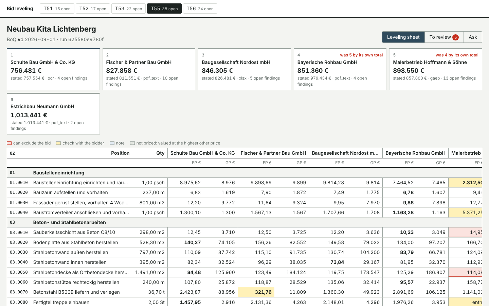
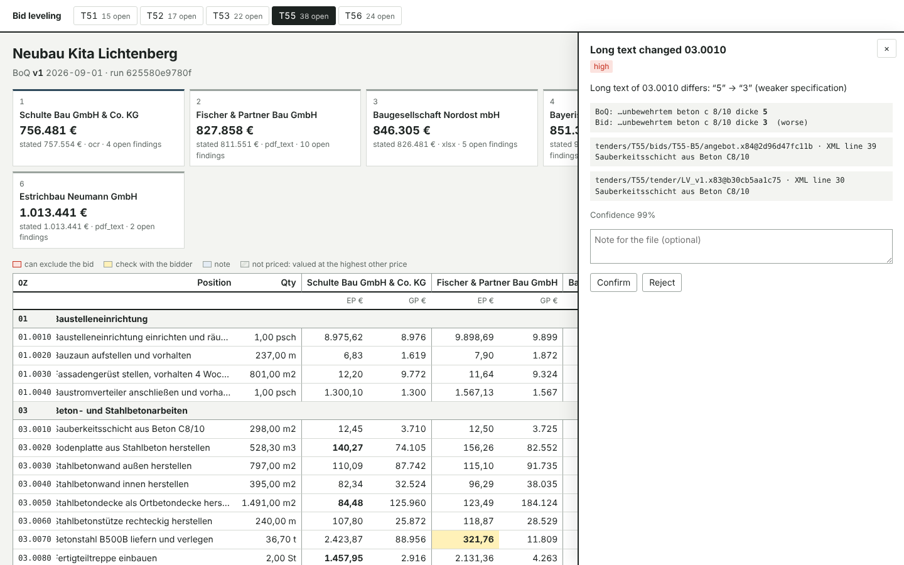
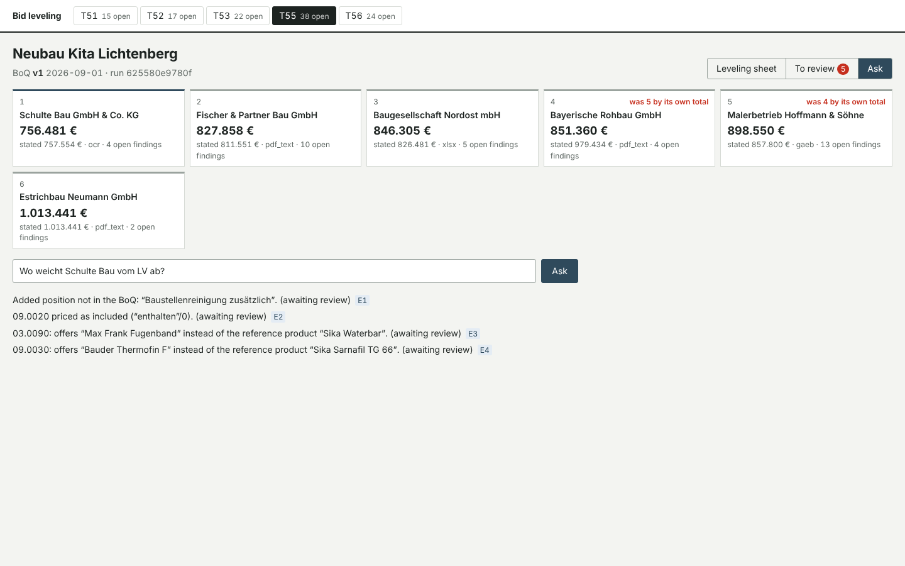

# bid-leveling-engine

**Show me where the bid deviates from the BoQ.** The engine reads construction bids in whatever
form they arrive: a GAEB file, a PDF from estimating software, a spreadsheet, or a printed-and-scanned
PDF. It matches every line to the position it prices in the Leistungsverzeichnis, even when bidders
renumber, abbreviate or reorder. It finds where each bid deviates (changed quantities, weaker long
texts, other products, reservations in the cover letter, arithmetic errors, missing prices,
speculative pricing, an outdated BoQ version) and levels the bids on comparable totals.

Every finding points at the page and box, the spreadsheet row or the XML line it came from. A
person reviews what the engine is unsure about, and their decisions survive the next run.



| | |
|---|---|
|  |  |

## Results

All numbers come from `reports/` and are regenerated by `ble run` and `ble heldout`; CI reruns them
on every push.

**On bids written by someone who never saw the code.** The bids in each held-out set (and, from v2
on, the BoQs too) were written by an agent that read only [heldout/WRITING_BIDS.md](heldout/WRITING_BIDS.md).
Each set is run once and its first run is kept ([ADR 0004](docs/adr/0004-held-out-sets.md)).

| Held-out set | Bids | Run | Precision | Recall | Wrong findings auto-confirmed | Lines matched to the right position |
|---|---|---|---|---|---|---|
| **v2** (BoQs and bids blind: façade/finishing works and civil works) | 11 | **first run** | **84.6%** | **86.8%** | **2 of 19** | **100%** (355 lines; position number alone: 37%) |
| v1 (bids blind, BoQs by the author: shell construction and fit-out) | 11 | first run | 23.6% | 75.6% | 38 of 61 | 55–100% by route (scans worst) |
| v1, after its failures were studied (now a regression set) | 11 | latest | 100% | 97.8% | 0 of 30 | 100% |

On v2's first run, 5 deviations were missed: 4 reservations worded in ways the patterns don't cover,
and 1 arithmetic error on a scan. There were 6 false findings:
- an "offered product" line read as long text (2);
- prices OCR lost on one scan, reported as missing (4).

German search did poorly on v2's queries: the right position was in the top 3 for 32% of queries,
against 24% for plain words. The queries use words that are not in the BoQs at all (Steinwolle for
Mineralwolle, Panikschloss, Attikablech), and the lexicon has no façade or civil-works vocabulary yet.
That is the next piece of work: per-trade vocabulary, and embeddings for paraphrase.
[First-run report](reports/heldout/v2/FIRST_RUN.md).

The first run of v1 was poor, and the reasons are listed in
[its report](reports/heldout/v1/FIRST_RUN.md):
- a scan whose "m²" OCR could not read;
- spreadsheets with shortened position numbers ("3.10") and estimator shorthand ("AW STB 25cm");
- one unmatched line turning into two false findings, an added position and a missing one;
- reservation patterns stopped by the dots in dates.

These were fixed, v1 became a regression set, and v2 was written blind to measure the fixed engine. v2 has not been studied or tuned on.

**On simulated tenders** (20 tenders, 106 bids; 8 test tenders scored here; [reports/EVALUATION.md](reports/EVALUATION.md)):

| | Test tenders |
|---|---|
| Findings precision / recall | 96.5% / 98.8% (168 found, 6 false, 2 missed) |
| Wrong findings that were auto-confirmed (rest go to review) | 0 of 134 |
| Lines matched to the right position: renumbered PDFs / scans | 100% / 100% (position number alone: 63.5% / 64.7%) |
| Bids whose priced BoQ version (addendum) was identified | 42 of 42 |
| German BoQ search, right position first: construction tokenizer / plain words | 100% / 47.7% (hit@3 100% / 53.0%) |

The simulated world was written by the engine's author, so these numbers are a ceiling; the held-out
sets are the honest measure.

Ingestion on a 2-core container, with OCR timed cold (`reports/ingest.json`):

| Route | Pages | Pages per minute | € per page (config/ingest.yaml) |
|---|---|---|---|
| GAEB | 62 | ~4,500 | 0.0001 |
| XLSX | 36 | ~3,000 | 0.0001 |
| PDF text layer | 87 | ~1,100 | 0.0002 |
| OCR (300 dpi, deu) | 54 | ~9 per core | 0.002 |

At 10,000 documents a day (~3 pages, 20% scans) OCR is ~6,000 pages ≈ 11 CPU-hours, a few workers;
everything else is negligible. OCR results are cached by file hash, page and settings.

## How it works

```
GAEB X83 (v1, v2 …)    bids: GAEB X84 · PDF · XLSX · scan + cover letters
        │                         │
   read_tender               read_bids ── per page: text layer or OCR (tesseract deu); arithmetic repair;
        │                         │       evidence on every value (doc@sha256, page+box | row | XML line)
        └──────────┬──────────────┘
           resolve_positions ── which addendum was priced; which position each line prices
                   │            (logistic matcher, one-to-one assignment, second pass by quantity + neighbours)
           detect_deviations ── 13 rules (config/rules.yaml); confidence = reading × match; < 0.9 → review
                   │
              level_bids ────── Preisspiegel: comparable totals; missing prices valued at the highest other price
                   │
             build_graph ────── ontology v1 (config/ontology.yaml), lineage on nodes and edges
                   │
   every step: decision-trace/1 (inputs by hash, code/config/model version, decisions, seconds, € cost)
                   │
   platform (TypeScript, Fastify, Postgres): runs, findings, review decisions, chat turns, API keys, /metrics
   AI service (FastAPI): chat with citations + verifier, search, evidence crops (hash-checked)
```

- **Rules decide, models read** ([ADR 0001](docs/adr/0001-rules-decide.md)). A finding can exclude a
  bid (VOB/A § 16), so it comes from a rule over extracted values, with evidence and a rule version.
  Models read: OCR, the position matcher, and (optionally, `BLE_CHAT_MODEL`) the phrasing of a chat
  answer, held to the same evidence by the verifier.
- **German construction text.** `src/ble/text/de.py` folds umlauts and their ae/oe/ue spellings, expands
  estimator shorthand (Stb., KS, TSD, AW), splits compounds into known parts (Stahlbetonwand → stahl
  beton wand), keeps specification codes whole (C30/37, REI 90, T30-RS) and canonicalises units.
  The vocabulary is in `config/lexicon.yaml`, extendable per customer.
- **Long texts compared as specifications.** C30/37 → C25/30, EI 90 → EI 30, a thinner layer or a higher
  thermal conductivity is flagged as *weaker*; the direction comes from the keyword nearest the value.
- **Decision traces** (`src/ble/harness/trace.py`). A new use case is a new list of steps; tracing,
  retries, cost accounting and a Langfuse export come with the harness.
- **Build vs buy** decisions are written down: [Postgres without an ORM](docs/adr/0002-postgres-without-orm.md),
  [routing documents to OCR](docs/adr/0003-ocr-routing.md). See also [ARCHITECTURE](docs/ARCHITECTURE.md)
  and the [RUNBOOK](docs/RUNBOOK.md).

## Run it

```
pip install -e ".[dev]"            # plus tesseract-ocr and tesseract-ocr-deu for scans
ble run                            # simulate tenders, read, match, detect, level, score, release gate
ble heldout --version v2           # re-run a held-out set (first runs are never overwritten)
pytest -q                          # 67 Python tests (-m "not slow" for the fast ones)
cd platform && npm ci && npm test  # 9 API tests against Postgres (TEST_DATABASE_URL)

docker compose up -d --build       # Postgres, platform + review UI on :3000, AI service on :8001
docker compose run --rm seed       # level the test tenders and publish them
```

## Repository

| Path | What |
|---|---|
| `src/ble/ingest` | GAEB, XLSX, PDF text and OCR readers, table parser, OCR repair |
| `src/ble/text/de.py` | German construction tokenizer and BM25 |
| `src/ble/resolve` | Position matcher, assignment, version detection, training |
| `src/ble/deviate` | Deviation rules and the leveling sheet |
| `src/ble/graph`, `config/ontology.yaml` | Project graph with lineage |
| `src/ble/harness`, `src/ble/workflows.py` | Workflow harness and decision traces |
| `src/ble/chat.py`, `src/ble/service` | Chat with citations, AI service |
| `platform/` | TypeScript API, Postgres schema, review UI |
| `src/ble/sim`, `world/` | The simulated tender world (never read by the engine) |
| `src/ble/evals`, `heldout/`, `reports/` | Scoring, held-out sets, results |

## Limits

- The simulated tenders and the v1 BoQs were written by the engine's author. The held-out sets are small
  (11 bids each), so their numbers move by several points with one bid.
- Bids are rendered from scripts. Real estimating software prints many more layouts, and real scans
  include photos, stamps and handwriting; none of those are covered yet.
- BIM (IFC) and drawings (DWG/PDF plans) are not read. The ontology has room for them, but no reader.
- The lexicon and the shorthand list were extended after studying held-out v1; v2 measures how far
  that carries.
- The chat is deterministic by default. A model is used only when configured, and it is held to the evidence.
- Prefect orchestration is optional (`pip install .[prefect]`); the harness runs without it.
